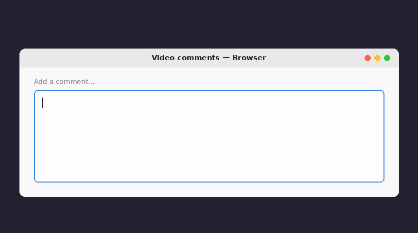

# Voice Input

Offline voice typing for the Linux desktop. Press a shortcut, speak, press it again — the text
appears wherever the cursor is: a browser field, YouTube comments, a chat, an editor or a terminal.

Speech is recognised on your computer with [Whisper](https://github.com/openai/whisper) (through
[faster-whisper](https://github.com/SYSTRAN/faster-whisper)). No account, no cloud, no audio
leaves the machine.



*An illustration of the workflow, drawn by [`scripts/make_demo_gif.py`](scripts/make_demo_gif.py)
(not a screen recording).*

- **Languages:** English, Russian and Hebrew — one shortcut per language, plus automatic detection
  limited to these three.
- **Works everywhere:** GNOME on Wayland (first-class), other Wayland desktops, and X11.
- **Fast on a laptop CPU:** the default `small` model recognises a sentence in about two seconds on
  a 4-core Intel i7; a CUDA GPU is used automatically when present.
- **Licence:** MIT.

Version 0.1.0, alpha.

## Quick start

```bash
# 1. System libraries (usually already present on Ubuntu desktop)
sudo apt install libportaudio2 libnotify-bin

# 2. Install from GitHub with uv (https://docs.astral.sh/uv/)
uv tool install git+https://github.com/kursluzz/voice-input

# 3. Shortcuts, start at login, and permission to paste (asks for your sudo password once)
voice-input setup all

# 4. Check everything
voice-input doctor
```

Now click into any text field, press **Super+T**, speak, and press **Super+T** again. The first
dictation downloads the speech model (about 480 MB for `small`); run `voice-input download` to do
that in advance.

## Shortcuts

| Shortcut | Action |
|---|---|
| **Super+T** | Dictate in the default language (`auto`: detect English, Russian or Hebrew) |
| **Shift+Super+E** | Dictate in English |
| **Shift+Super+R** | Dictate in Russian |
| **Shift+Super+H** | Dictate in Hebrew |

The first press starts recording (a rising tone and a "Recording" notification). The next press
of **any** of these shortcuts stops, recognises and types (a falling tone). Recording also stops
by itself after five minutes. `voice-input cancel` throws a recording away; bind it to a key with
the `cancel` entry in the [configuration](docs/CONFIGURATION.md#shortcuts).

The keys are configurable. `voice-input setup shortcuts` installs them in GNOME and warns about
conflicts; on other desktops, bind the commands from the table below in your keyboard settings.

## How it works

```
 shortcut ─▶ voice-input toggle ─▶ daemon (Unix socket)
                                     │ 1st press: record the microphone (16 kHz)
                                     │ 2nd press: Whisper → text
                                     ▼
                     clipboard + primary selection ← text
                     virtual keyboard: Shift+Insert ─▶ focused window
```

A small background daemon keeps the model in memory, so recognition starts at once. The shortcut
starts the daemon if it is not running yet. The text is put on the clipboard and the primary
selection, then a virtual keyboard presses **Shift+Insert**, which pastes in browsers, editors and
terminals alike — and works for Cyrillic and Hebrew in any keyboard layout. Details are in
[docs/ARCHITECTURE.md](docs/ARCHITECTURE.md).

## Installation

Voice Input is installed from GitHub (it is not on PyPI). Requirements: Linux with a graphical
session, Python 3.12–3.14 (uv installs one if needed), PortAudio (`libportaudio2`).

| Tool | Command |
|---|---|
| [uv](https://docs.astral.sh/uv/) (recommended) | `uv tool install git+https://github.com/kursluzz/voice-input` |
| uv, a specific release | `uv tool install git+https://github.com/kursluzz/voice-input@v0.1.0` |
| [pipx](https://pipx.pypa.io/) | `pipx install git+https://github.com/kursluzz/voice-input` |
| pip, in a virtual environment | `pip install git+https://github.com/kursluzz/voice-input` |
| From a clone | `git clone https://github.com/kursluzz/voice-input && cd voice-input && uv tool install .` |

Then run `voice-input setup all` (or the parts you want, see below) and `voice-input doctor`.

- **Upgrade:** `uv tool upgrade voice-input` (or `pipx upgrade voice-input`), then
  `voice-input shutdown` so the next shortcut starts the new version (with the login service:
  `systemctl --user restart voice-input`).
- **Uninstall:** `voice-input setup all --remove`, then `uv tool uninstall voice-input`.

[docs/INSTALLATION.md](docs/INSTALLATION.md) covers each step, other desktops, X11, and where files
are kept.

### What `setup` does

| Command | Effect | Undo |
|---|---|---|
| `voice-input setup shortcuts` | Adds the GNOME custom shortcuts from the table above | `--remove` |
| `voice-input setup service` | Installs and starts a systemd user service, so the model is loaded at login | `--remove` |
| `voice-input setup uinput` | Installs a udev rule that lets you (only the logged-in user) create a virtual keyboard; runs `sudo` | `--remove` |
| `voice-input setup all` | All three | `--remove` |

Add `--dry-run` to see what would be done. Without the uinput permission Voice Input still works,
but only copies the text: you paste it yourself with Ctrl+V.

## Commands

| Command | What it does |
|---|---|
| `voice-input toggle [--lang auto\|en\|ru\|he]` | Start recording, or stop and type — bind this to a key |
| `voice-input start` / `stop` / `cancel` | Explicit control of a dictation |
| `voice-input status` | What the daemon is doing (`--json` for scripts) |
| `voice-input shutdown` | Stop the daemon |
| `voice-input daemon` | Run the daemon in the foreground (to see its log) |
| `voice-input listen [--lang ru]` | Record until Enter and print the text — handy in a terminal |
| `voice-input transcribe FILE.wav… [--lang he] [--json]` | Transcribe WAV files |
| `voice-input devices` | List microphones |
| `voice-input download [MODEL…]` | Download models ahead of time |
| `voice-input doctor` | Check the installation and explain fixes |
| `voice-input config [--example\|--path]` | Show the effective configuration |

## Configuration

Optional, in `~/.config/voice-input/config.toml`. `voice-input config --example` prints a
commented file with every setting. The most useful ones:

```toml
language = "ru"            # default for Super+T: auto, en, ru or he
model = "small"            # tiny, base, small, medium, large-v3-turbo, …
input_device = "USB"       # part of the microphone's name (see `voice-input devices`)
trailing_space = true      # add a space so consecutive dictations do not run together

[models]
he = "ivrit-ai/whisper-large-v3-turbo-ct2"   # a better Hebrew model (slower on a CPU)
```

All settings, environment variables and shortcut keys: [docs/CONFIGURATION.md](docs/CONFIGURATION.md).
Speed and accuracy of the models: [docs/MODELS.md](docs/MODELS.md).

## Privacy

- Audio is recorded only between the two shortcut presses, kept in memory, and discarded after
  recognition. Nothing is written to disk, nothing is sent anywhere.
- The only network access is the one-time model download from Hugging Face.
- The log (`~/.local/state/voice-input/logs/`) records timings, languages and text lengths, never
  the text itself.
- The daemon's socket is private to your user (mode 0600 in a 0700 directory).
- The transcript stays on the clipboard after pasting, like any copied text
  (`restore_clipboard = true` puts the previous clipboard text back instead).

## Troubleshooting

Start with `voice-input doctor`. Common cases:

| Symptom | Fix |
|---|---|
| "Copied to the clipboard" instead of typing | Run `voice-input setup uinput`, or paste with Ctrl+V. |
| Nothing happens on the shortcut | Run `voice-input toggle` in a terminal to see the error; check `voice-input setup shortcuts` reported no conflict. |
| "Nothing recognised" | Check the microphone with `voice-input devices` and `voice-input listen`; set `input_device`. |
| Text appears in the wrong language | Use the language's own shortcut instead of auto-detection (short phrases are hard to detect). |
| Terminal pastes something else | Terminals paste the primary selection with Shift+Insert; Voice Input sets both. If your terminal differs, set `paste_keys = "ctrl+shift+v"`. |
| First dictation is slow | The model is being downloaded and loaded; later ones are fast. `voice-input setup service` loads it at login. |

More in [docs/TROUBLESHOOTING.md](docs/TROUBLESHOOTING.md).

## Limitations

- Linux only. Automatic shortcut setup is for GNOME; other desktops need the shortcuts set by hand.
- Toggle, not push-to-talk: desktop shortcuts report key presses, not releases.
- Text is pasted at the end of a dictation, not streamed while you speak.
- Short utterances (one or two words) can be misdetected in `auto` mode; use the language keys.

## Development

```bash
git clone https://github.com/kursluzz/voice-input && cd voice-input
uv sync
uv run pytest
uv run ruff check . && uv run ruff format --check . && uv run mypy
```

See [CONTRIBUTING.md](CONTRIBUTING.md). Plans and progress are tracked in
[GitHub milestones](https://github.com/kursluzz/voice-input/milestones) and
[issues](https://github.com/kursluzz/voice-input/issues).

## Licence

MIT — see [LICENSE](LICENSE). Whisper models have their own licences (OpenAI Whisper weights are
MIT; check third-party models such as ivrit-ai before use).
